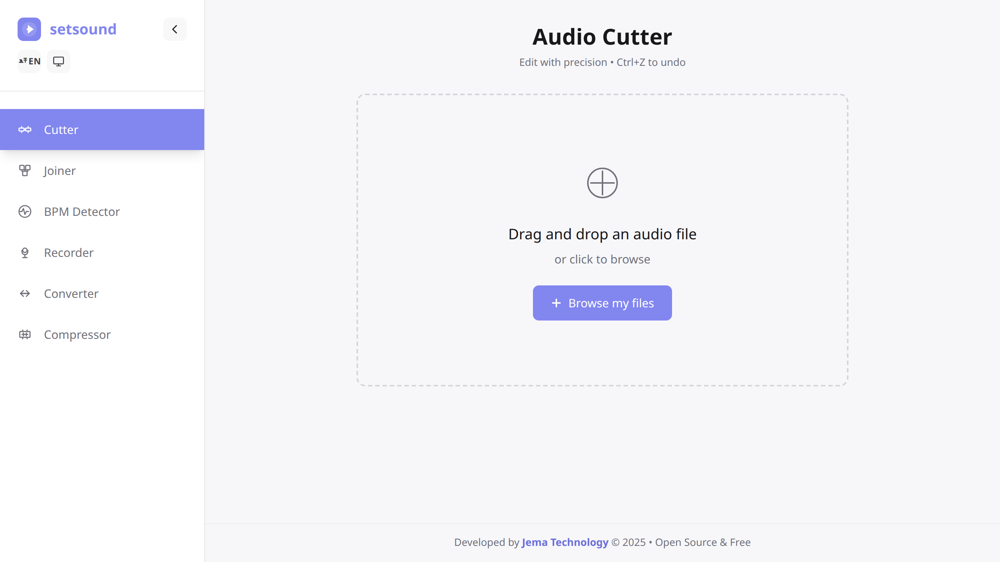
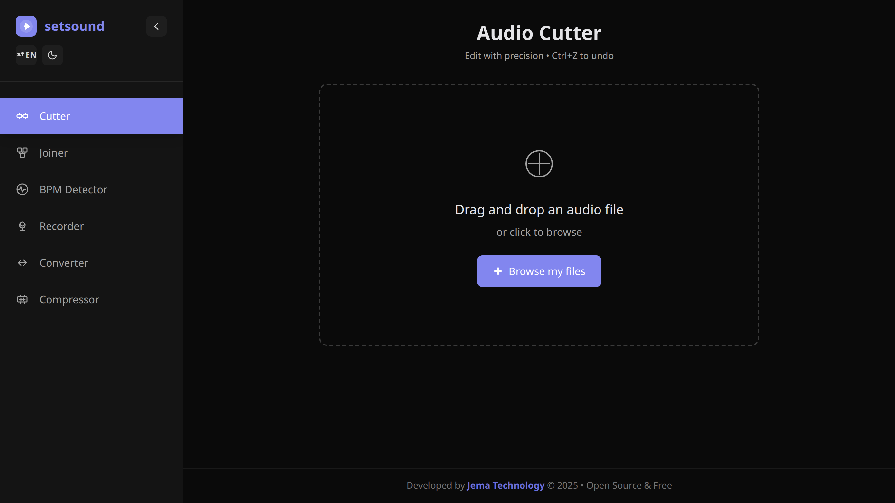

<div align="center">


# SetSound

### The complete audio toolkit that runs entirely in your browser

[](https://www.jematechnology.fr)
[](LICENSE)
[](https://react.dev)
[](https://www.typescriptlang.org)
[](https://vitejs.dev)
[](https://webassembly.org)
[](#-install-as-a-pwa)
[](#-contributing)

**Cut · Join · Convert · Record · Compress · Detect BPM** — all locally, no upload, no account.

[Features](#-features) · [Screenshots](#-screenshots) · [Getting started](#-getting-started) · [Tech stack](#-tech-stack) · [License](#-license)

</div>



---

## ✨ Features

| Tool | What it does |
| --- | --- |
| ✂️ **Cutter** | Trim audio on a precise waveform viewer with zoom and undo/redo |
| 🔗 **Joiner** | Merge several tracks into a single file |
| 🥁 **BPM Detector** | Detect the tempo of any track in one click |
| 🎙️ **Recorder** | Record straight from your microphone, in the browser |
| 🔄 **Converter** | Convert between MP3, WAV, FLAC and more |
| 🗜️ **Compressor** | Shrink file size while keeping the quality you need |

Plus:

- 🖱️ **Drag & drop** — drop a file and start editing
- 🌗 **Light / dark theme**
- 🌍 **English / French UI**
- ⌨️ **Keyboard shortcuts** (undo `Ctrl/Cmd+Z`, …)
- 📶 **Works offline** — installable PWA
- 🔒 **100% private** — nothing ever leaves your device

---

## 📸 Screenshots

| Light | Dark |
| :---: | :---: |
|  |  |

---

## 🚀 Getting started

### Prerequisites

- [Node.js](https://nodejs.org) 18+
- npm

### Development

```bash
git clone https://github.com/JemaOS/setsound.git
cd setsound
npm install
npm run dev
```

### Build

```bash
npm run build      # production build in dist/
npm run preview    # preview the build locally
```

### Tests

```bash
npm test           # unit tests (Vitest)
npm run test:e2e   # end-to-end tests (Playwright)
```

### Install as a PWA

Open the deployed app in Chrome, Edge, Brave or Safari and click **Install**. It then works offline.

---

## 🛠️ Tech stack

- **React 18** + **TypeScript**
- **Vite** build tooling
- **WebAssembly**: `@ffmpeg/ffmpeg`, `mediabunny`, `lamejs`, `@wasm-audio-decoders/flac`, `web-audio-beat-detector`
- **Web Audio API** for playback, waveforms and recording
- **Vitest** + **Playwright** for tests

---

## 📁 Project structure

```
src/
├── components/     # UI (cutter, joiner, recorder, …)
├── hooks/          # audio + state hooks
├── i18n/           # English / French translations
└── SubscriptionGuard.tsx   # JemaOS Pro session handling
```

---

## 🤝 Contributing

Contributions are welcome! Fork the repo, create a branch, and open a pull request.

```bash
git checkout -b feat/my-feature
git commit -m "feat: my feature"
git push origin feat/my-feature
```

---

## 📄 License

Released under the **MIT License** — see [LICENSE](LICENSE).

<div align="center">
Made with ❤️ by <a href="https://www.jematechnology.fr">Jema Technology</a>
</div>
